<p align="center"></p>

<h1 align="center">LegacyLyrion A200</h1>

<p align="center">
A Spotify, YouTube Music and local-library remote <i>and</i> player for <a href="https://lyrion.org">Lyrion Music Server</a>,<br>
for Sony Ericsson's 2009 Java phones: the Aino, W995, C905, W705 and the rest of the A200 family.
</p>

<p align="center">
<a href="../../releases/latest">Download</a> ·
<a href="docs/setup-guide.md">Setup guide</a> ·
<a href="#supported-phones">Supported phones</a> ·
<a href="#building">Building</a>
</p>

<p align="center">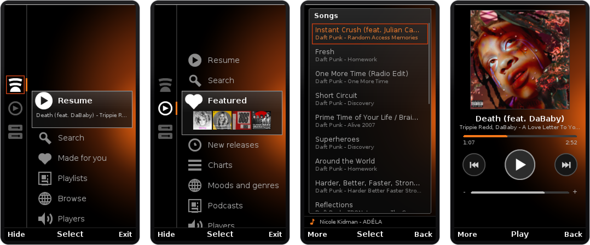</p>

LegacyLyrion A200 is the Java ME sibling of [LegacyLyrion for Android](https://github.com/h33ted/LegacyLyrion). It is a single CLDC 1.1 / MIDP 2.0 MIDlet that looks and behaves like the media apps Sony Ericsson shipped on these phones (PlayNow, Walkman): a black and orange home menu with glass preview boxes, list panels with an orange focus frame, and the familiar *More / Select / Back* soft keys. Behind that sits Lyrion, which does the heavy lifting, so a phone from 2009 can browse Spotify, YouTube Music and your own library, control every player in the house, and play music itself.

## Features

- **Spotify first.** Browse *Made for you* (your Daily Mixes), your playlists and *Browse*, and search songs, artists, albums and playlists, through the [Spotty](https://github.com/michaelherger/Spotty-Plugin) plugin. See [Add Spotify with the Spotty plugin](docs/setup-guide.md#2-add-spotify-with-the-spotty-plugin).
- **YouTube Music.** Featured, New releases, Charts, Moods and genres and Podcasts, plus search, through the [YouTube Music for LMS](https://github.com/schmij97/lms-ytmusic) plugin. See [Optional: YouTube Music](docs/setup-guide.md#optional-youtube-music).
- **Local library.** Recently added, Albums, Artists, Genres and Playlists from the music stored on your Lyrion server, with the same search.
- **Sources follow your server.** On first start the app [checks which plugins Lyrion has](docs/setup-guide.md#5-first-start) and only shows those sources on the home rail; the library is always there.
- **The phone is a player.** With [Play on this phone](docs/setup-guide.md#6-play-on-the-phone-itself) the phone becomes a real Squeezebox player over SlimProto ([`Slim.java`](src/ll/Slim.java)), named after the model, for example `Sony Ericsson - U10i`, with two playback modes: [chunked or direct stream](docs/setup-guide.md#playback-modes).
- **Remote for any player.** The [Players](docs/setup-guide.md#controls) entry lists every Lyrion player (Squeezebox, piCorePlayer, squeezelite, an Android phone running LegacyLyrion) and controls the one you pick.
- **Now Playing** with artwork, progress, skip, play/pause and volume ([`NowPlayingScreen.java`](src/ll/NowPlayingScreen.java)), plus *Play now*, *Play next* and *Add to queue* from the [More menu](docs/setup-guide.md#controls) on any song, album or playlist.
- **Keypad and touch.** Full D-pad and number-key control on the 240x320 phones, and touch with drag-scrolling on the Aino; [multi-tap typing](docs/setup-guide.md#controls) straight into the search box on the home menu.
- **Native look.** Drawn in the style of Sony Ericsson's own 2009 media apps ([`Style.java`](src/ll/Style.java), [`HomeScreen.java`](src/ll/HomeScreen.java)); the layout adapts to 240x432 and 240x320 screens.
- **Docked mode (Aino).** Stand the Aino sideways and leave it still, in its desk stand for example, and it asks *Docked?*: it then keeps the screen on and shows the artwork, a large standby-style clock, and the title and album; touch it for the controls. At night it can switch to a dimmed red-on-black look ([`DockScreen.java`](src/ll/DockScreen.java), [`Docking.java`](src/ll/Docking.java)). [Always or off, and the wait before docking](docs/setup-guide.md#docked-mode-aino), are in Settings.
- **Screen rotation** follows the phone's accelerometer (JSR-256, [`Tilt.java`](src/ll/Tilt.java)), with an *Always upright* option in [Settings](docs/setup-guide.md#settings).
- **Hide** sends the app to the background while music keeps playing.
- **Diagnostics log** with every request, SlimProto command and stream URL, for [troubleshooting](docs/setup-guide.md#diagnostics-log).
- **Installs on picky firmware.** Jars are packed the way 2000s installers expect ([`tools/Pack.java`](tools/Pack.java)), and ECJ writes preverified CLDC class files, so no Sun WTK or preverifier is needed to [build](#building).

## Screenshots

**Aino** (240x432, touch and keypad)

<table>
<tr>
<td align="center">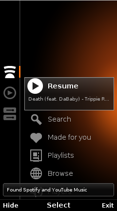<br><sub>First start finds the plugins</sub></td>
<td align="center">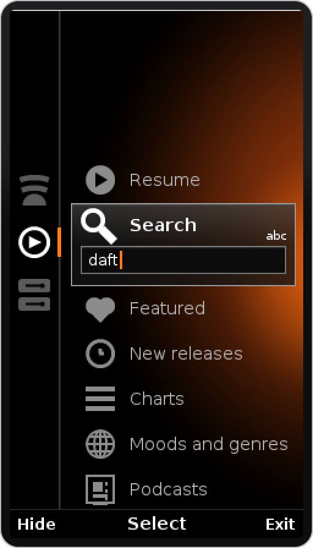<br><sub>Type straight into Search</sub></td>
<td align="center">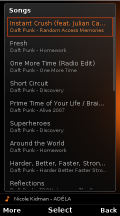<br><sub>Search results</sub></td>
<td align="center">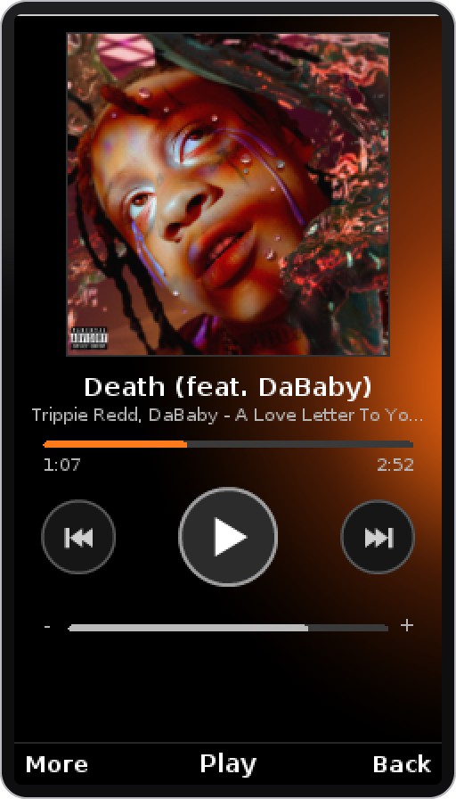<br><sub>Now Playing</sub></td>
</tr>
<tr>
<td align="center">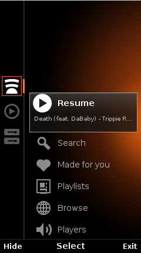<br><sub>Source rail: Spotify, YouTube Music, library</sub></td>
<td align="center">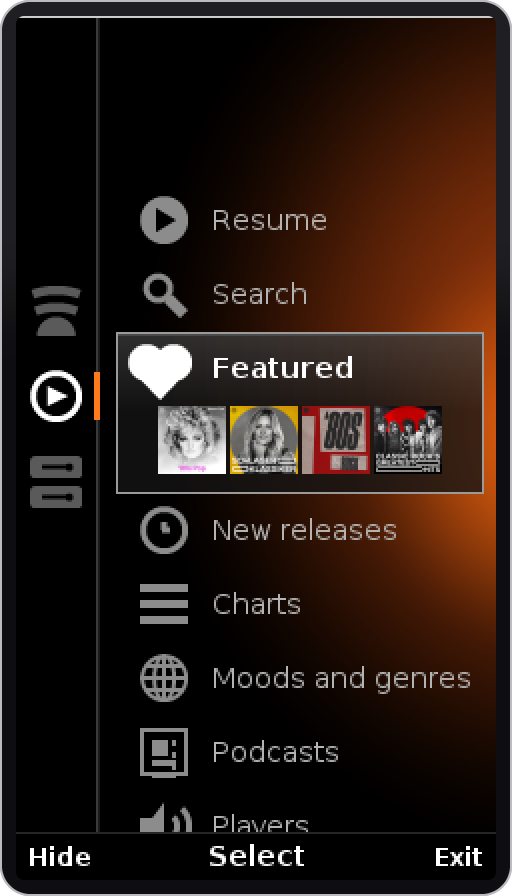<br><sub>YouTube Music home</sub></td>
<td align="center">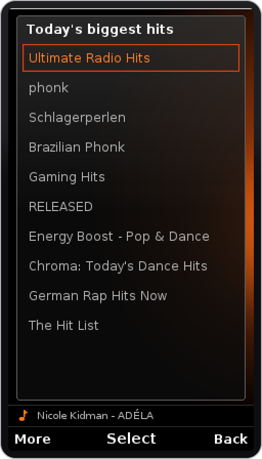<br><sub>Featured playlists</sub></td>
<td align="center">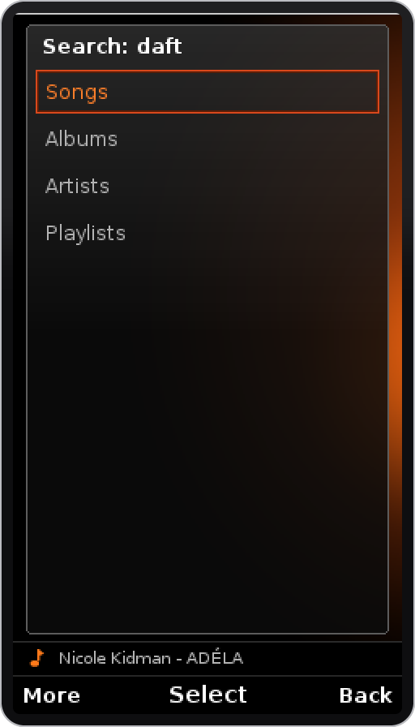<br><sub>Songs, albums, artists, playlists</sub></td>
</tr>
</table>

**W995, C905, W705 and the other 240x320 phones** (keypad)

<table>
<tr>
<td align="center">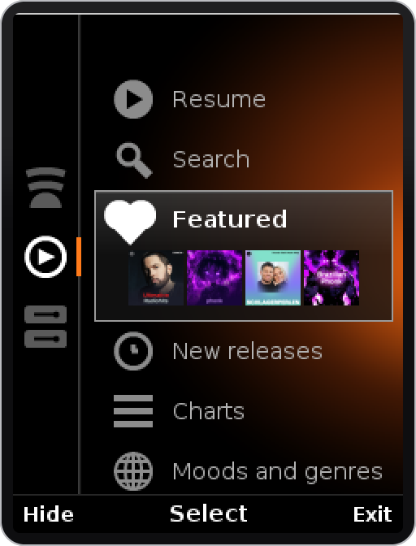<br><sub>Home</sub></td>
<td align="center">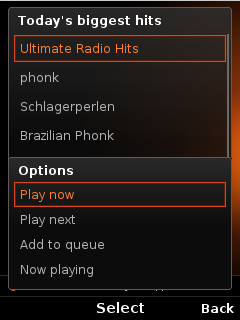<br><sub>More menu</sub></td>
<td align="center">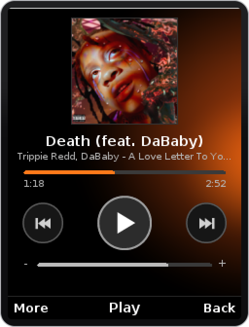<br><sub>Now Playing</sub></td>
<td align="center">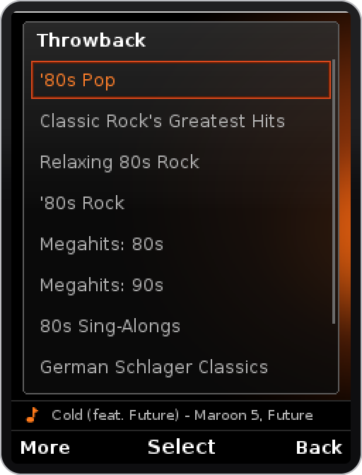<br><sub>Playlists</sub></td>
</tr>
</table>

Screenshots are from MicroEmulator 2.0.4 at the phones' native resolutions.

## Supported phones

One jar runs on every A200-platform phone (Java Platform 8.4 / 8.5); the layout follows the screen. It comes in two labelled copies so it is obvious which one to pick:

| Download | For |
|---|---|
| `LegacyLyrion-Aino.jar` + `.jad` | Sony Ericsson **Aino** (U10i), 240x432, touch and keypad |
| `LegacyLyrion-A200.jar` + `.jad` | The **240x320** keypad phones of the same generation |

| Phone | Screen | Wi-Fi | Tested |
|---|---|---|---|
| Aino (U10i) | 240x432, touch | Yes | On the phone |
| W705 | 240x320 | Yes | On the phone |
| W995, C905, W715, G705, Elm, Hazel | 240x320 | Yes | Emulator only |
| C903, C901, C510, T715, W508, Naite, Yari, Zylo, Cedar | 240x320 | No (mobile data only) | Emulator only |

The app needs to reach your Lyrion server, so in practice a phone with Wi-Fi on the same network as the server. Wi-Fi varies by model and sometimes by carrier variant, so check yours. Reports from other phones are welcome as [issues](../../issues).

## Quick start

1. Set up **Lyrion Music Server** with **Spotty** (and optionally **YouTube Music for LMS**) on a computer at home: [setup guide, steps 1 to 3](docs/setup-guide.md#1-install-lyrion-music-server).
2. Download the right `.jar` **and** `.jad` from the [latest release](../../releases/latest), copy both to the phone, and open the `.jad`: [step 4](docs/setup-guide.md#4-install-the-app-on-the-phone).
3. Allow network access permanently, enter the server's IP address and port `9000`, and play something: [step 5](docs/setup-guide.md#5-first-start).

Requirements in short: Lyrion 8 or 9, a Spotify **Premium** account for Spotty, and MP3 transcoding on the server (built into the Windows and macOS packages; `lame` on Linux). Linux or a Mac is the recommended server host; see [Windows: several network adapters](docs/setup-guide.md#windows-several-network-adapters) if you use Windows.

## Building

```sh
sh build.sh        # Linux, macOS, WSL
build.cmd          # Windows
```

You need **JDK 11 or newer** on the PATH, and nothing else. On the first build the scripts download three jars from Maven Central into `lib/`:

- [ECJ 4.6.1](https://repo1.maven.org/maven2/org/eclipse/jdt/core/compiler/ecj/4.6.1/), the Eclipse compiler, whose `cldc1.1` target writes preverified, Java 1.1-era class files the phones accept;
- [MicroEmulator's CLDC 1.1](https://repo1.maven.org/maven2/org/microemu/cldcapi11/2.0.4/) and [MIDP 2.0](https://repo1.maven.org/maven2/org/microemu/midpapi20/2.0.4/) API stubs to compile against.

The output is `dist/LegacyLyrion-Aino.jar` / `.jad` and `dist/LegacyLyrion-A200.jar` / `.jad`. Set `VER=0.7.0` to override the version, or `LL_SERVER=192.168.1.20:9000` to build a test copy into `dist-test/` with the server address preset.

To try it on a PC, run the Aino or A200 `.jad` in [MicroEmulator 2.0.4](https://github.com/barteo/microemu) and pick a 240x432 or 240x320 device skin.

Pushing a tag such as `v0.6.1` builds both jars on GitHub Actions and publishes them as a release ([`.github/workflows/release.yml`](.github/workflows/release.yml)).

## How it works

- **Browsing and control** use Lyrion's JSON-RPC API over HTTP ([`Lms.java`](src/ll/Lms.java), with a small CLDC JSON parser in [`Json.java`](src/ll/Json.java)). Spotify and YouTube Music come through the plugins' Squeezebox-controller (Jive) menus, the same ones a Squeezebox Touch uses, so both share one code path ([`Item.java`](src/ll/Item.java)).
- **Playback on the phone** is a SlimProto client on TCP 3483 ([`Slim.java`](src/ll/Slim.java)) that asks Lyrion for MP3 and either cuts it into roughly 256 KB frame-aligned pieces played back to back, or hands the stream to the phone's player directly.
- **Every request opens its own connection.** These phones otherwise reuse a kept-alive connection that Lyrion has already closed, and the request fails with "response empty".
- **The UI** is one full-screen canvas ([`Shell.java`](src/ll/Shell.java)) that draws the chrome, soft keys and More menu, and routes keys and touch to the current screen ([`HomeScreen.java`](src/ll/HomeScreen.java), [`ListScreen.java`](src/ll/ListScreen.java), [`NowPlayingScreen.java`](src/ll/NowPlayingScreen.java)). Colours, gradients and the drawn glyphs live in [`Style.java`](src/ll/Style.java).
- **App logic**, settings (stored in RMS) and the source menus are in [`LegacyLyrion.java`](src/ll/LegacyLyrion.java).
- **Sensors:** [`stubs/`](stubs/javax/microedition/sensor) holds compile-time stand-ins for the JSR-256 API the phones provide; they are never packaged.

## Related

- [LegacyLyrion](https://github.com/h33ted/LegacyLyrion): the Android 4.0+ version, with the same idea for Sony, HTC, LG and Samsung phones of 2011 to 2014.

## Credits

See [NOTICE](NOTICE). Spotify is a trademark of Spotify AB; YouTube and YouTube Music are trademarks of Google LLC; Sony Ericsson, Aino and Walkman belong to their owners. This project is not affiliated with Spotify, Google, Sony, the Lyrion project or Logitech. Spotify and YouTube Music playback depend on third-party plugins (Spotty, YouTube Music for LMS) that describe themselves as unofficial and may stop working when those services change; use them at your own risk and within the services' terms.
